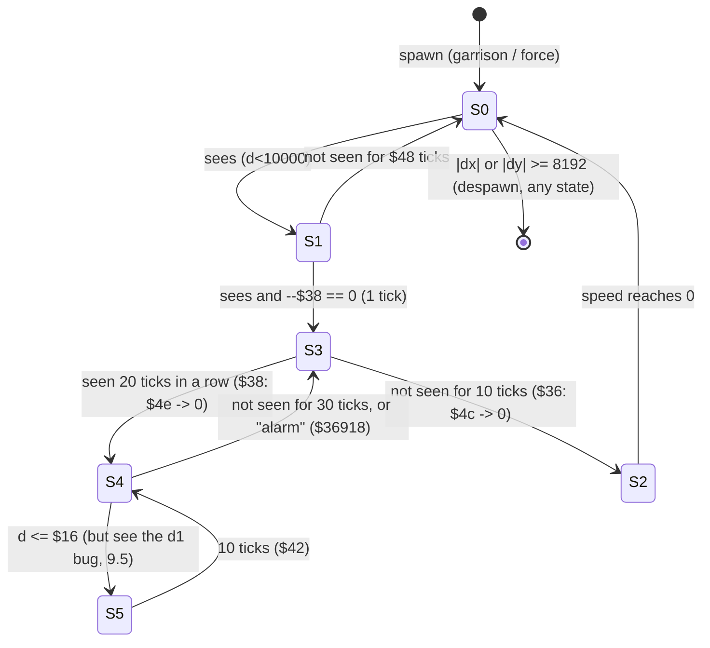

# Midwinter 2: how the enemy AI works

Scope: the Atari ST binary of *Midwinter 2: Flames of Freedom* (PP's HD build). Static evidence is disassembly of `work/dumps/ram_ingame_lobos.bin` (address = file offset; `python3 tools/m68dis.py <dump> <hex>`). Live evidence is Hatari runs of `work/snapshots/ingame_lobos_foot.sav`, driven by the scripts in `work/enemy_ai/` (raw logs in `work/enemy_ai/evidence/`). Anything not proven by one of those two is marked **[INFERENCE]**. The MW1 DOS decode (vcheckk-archive/midwinter-decode) is used only for the comparison in section 8.

Conventions: `$` = hex. "Tick" = one pass of the frame loop `$31486-$315de`. In the unpatched game a tick is about 12 VBL (0.24 s) at 8 MHz on a 1 MB STE; with our 5 Hz scheduler it is 0.2 s. All AI logic is per tick, never per VBL, so game speed scales with the frame rate (see `simtiming.md`). Positions are in "local units": 512 units = 1 terrain cell, origin `$6400`. An NPC with speed `v` moves `v/4` units per tick (measured: speed 290 gives 70-72 units/tick, section 4.1).

## Summary (for the article)

1. **One state machine for 22 vehicle types.** Idle -> alert -> hunt -> pursue <-> attack run, plus brake. Types differ by a data row (speed 190-600, fire range 2500-6000, aim time 8-32 ticks, two weapon ids), a movement mode (flier / ground / surface / submerged / seabed) and where they may spawn (land / deep water / anywhere). There is no flee, retreat or return-to-base.
2. **Enemies are samples of map units.** Garrisons (52 on Lobos) and Empire forces carry a strength, a threshold and a deployed counter. Within about 49 map units of you the game rolls them into the 30-slot NPC table, **at most 2 per unit (1 when crowded) and 5 hostile in all**, 6144 units out (12 cells), and gives them back when you are 8192 units (16 cells) away. Every kill removes one man from the unit; below the threshold the unit is gone for good.
3. **Detection is distance plus a forward cone, with no line of sight**: any hostile within 10000 units (19.5 cells) of its spawn notices you at once; while hunting it keeps you at 5000 (omnidirectional) or 8000 (22.5 degree cone) and forgets you after 10 ticks (hunt) or 30 ticks (pursue).
4. **Steering is rotation of unit vectors by a fixed 22.5 degrees per tick**, with the angle-difference identity on sine/cosine pairs. No atan, no tables beyond sine.
5. **Combat is a countdown, then a homing bullet, then a dice roll.** The enemy must keep you in a 22.5 degree cone and its fire range for 8-32 consecutive ticks, then launches a projectile that accelerates from 390 to 1500 (up to 375 units per tick), homes with a 3-tick lead inside 45 degrees and explodes within 200 units. If it ends within 150 units, a roll against a weapon x vehicle table (0-30 %, plus 1) decides if your vehicle is destroyed. There are no hit points on either side: your hits are also single rolls from your weapon x target table.
6. **The Empire invasion is a Dijkstra route over 43 locations**, forces marching 10 x speed map units per game hour from a mission-defined start day; free production speeds up their attrition.
7. **Bugs worth an article paragraph:** wander waypoints are east-west because of an `ext.l`/`swap` mismatch; foot figures freeze whenever you face them (hostile infantry too); a clobbered register makes a dead-ahead hunter think it is in attack range at 6000 units; the Zeppelin-raid code is unreachable; spawn initialisation reads the wrong table base.

## 0. Things earlier notes got wrong (verified here)

| Earlier claim | What the code and traces show |
|---|---|
| `$36ad8` is "projectiles, table `$40e4`" (`tick_inventory.md` 2.3) | It is **ambient traffic**: 25 path-following scenery vehicles (roads, rails, sea lanes) that turn into real NPCs (state 9) when you get close. No weapon is involved (section 6.5). |
| `$34adc` / `$34bbe` are "visibility/aim lists" | They are the **spawners**: they turn strategic-map units (garrisons, forces) into 3D NPCs (section 3.2). The visibility test is `$365b8/$365ec` plus `$35872`. |
| The firing routine `$36a7e` | `$36a7e` picks a **wander waypoint**, not a shot. Firing is `$36648` -> `$366a6` -> `$34f74` (section 5.1). |
| `$6220 = 13` is "on foot" | `$2e234-$2e23e` prints the vehicle name with `lea $1642f,a1; move.w $6220,d0; jsr $2fcd8`, i.e. `$6220` is a 0-based index into the 22 names (Tank, Jeep, Truck, Bus, Train, on foot, Speedboat, Crawler, Minisub, Submarine, Ship, Frogman, Biplane, Helicopter, Zeppelin, Balloon, Rocket Pack, Parachute, Flying Boat, Hovercraft, Flying Sub, Swimming). So **13 = Helicopter and on foot = 5** (`move.w #$5,$6220` is used when you step out, `$32e6a`). The cockpit-overlay skip list `{5,$15,$11}` in `cockpit.md` is then foot/swimming/parachute, which fits. I did not re-identify what the snapshot's vehicle really is; I only note that the name table disagrees with the "foot" label. |

## 1. The NPC table `$3532-$3cee`

30 slots x `$42` bytes (`$359f0 lea $3532,a5 ... lea $42(a5),a5; cmpa.l #$3cee`). Two more slots sit just before it: `$34ae` (a scratch slot that absorbs writes when the table is full, `$34edc`) and `$34f0` (a pseudo-entry for the player, used when the player rides a path vehicle, `$37626`). `$3502c` (called on island change, `$2dbb4`, and at load) marks every slot free: it writes ids -1, -2, ... -30 into `+0` and `$ffff` into `+$2e`.

### 1.1 Entry field map (a5)

| Off | Size | Meaning | Evidence |
|---|---|---|---|
| `+0` | w | slot id, -1..-30 (init only) | `$35034-$3503a` |
| `+2` | l | shape (model) pointer; refreshed every tick from the type record: `movea.l 2(a0),a1; move.l (a1),2(a5)` | `$35b10-$35b14` |
| `+6`, `+a` | l, l | position x, y (local units) | `$34eec`, mover `$37e50` |
| `+e` | w | altitude (same scale as the player's `$764c`) | `$34f3a`, `$37e38` |
| `+10` | w | last heading error: sin(target-heading), Q14. Its sign picks the dodge direction | `$37c36`, `$1be44` |
| `+12` | w | skid/spin accumulator: `$381d4` adds `$20` and rotates the heading when the next 3-tick position would be water; cleared when moving | `$38142`, `$38148` |
| `+14` | w | heading as an angle (0..`$3fe`, 1024 per turn, even values), cached from the heading vector by the arcsine search `$4f12` -> `$28e50` | `$35adc-$35aec` |
| `+16` | w | bank = 3 x change of `+14`, clamped to +/-`$80` (no wrap handling, so a spike at the 1023/0 wrap is clamped) | `$35af0-$35b04` |
| `+18` | w | speed | `$36ac4` |
| `+1a`, `+1c` | w, w | **heading unit vector** (sin, cos), Q14. x += sin*speed, y += cos*speed. The AI never stores heading as an angle for steering | `$37e3c-$37e54` |
| `+1e`, `+20` | w, w | pitch unit vector (sin, cos), Q14 (`0, $4000` = level) | `$34f4e-$34f54` |
| `+22`, `+26` | l, l | **target** x, y: the current wander waypoint, or the last-known player position | `$36a90`, `$3592c` |
| `+2a` | w | target altitude | `$36ab0`, `$3592c` |
| `+2c` | w | height above the surface for surface-riding movers (`$748e[type]` at `$34f1a`; `$74ce[type-1]` for map-spawned units at `$31a3a`) | `$38170` |
| `+2e` | w | **type**: 1..28 live; **0 = wreck/explosion debris**; -1 = free | `$359f4-$35a02` |
| `+30` | l | back-pointer to the map record this NPC was sampled from (garrison, force, vehicle, path record). Bit 31 set = that unit has just been destroyed. `$349e` = dummy | `$34f6a`, `$3643e` |
| `+34` | w | weapon id (projectile NPCs); animation phase for Tank (`$325f6`) and Helicopter rotor (`$32610`, +`$40`/tick) | `$34f9c`, `$325e2` |
| `+36` | w | countdown A (state 1: alert; 3/4: ticks since last seen; 7/12: lifetime) | section 4 |
| `+38` | w | countdown B (state 1/3: ticks seen; 5: attack-run length) | section 4 |
| `+3a` | w | **state** 0..12, dispatched through the table at `$35b30` | `$35b18-$35b2e` |
| `+3c` | w | countdown C (state 1: waypoint re-roll; 12: missile re-acquire; wreck: 25-tick life) | `$35bf6`, `$339f2` |
| `+3e` | w / l | aim countdown (non-missiles). For homing missiles it is a **long** pointer to the target NPC (`+3e..+41`) | `$36692`, `$36246` |
| `+40` | w | HUD target-lock persistence (`$32(a0)` of the type record) | `$36746` |

### 1.2 Spawn

One allocator: `$34eaa` (reached through the jump-table slot `$4f60`). It scans from slot 0 for the first slot with `$2e < 0` (no round robin), then `$34eec` initialises it from d0 = 0-based type (record = type+1), d2/d3 = x/y, `$68f8` = initial state, `$535e` = initial heading angle:

```
034eec  move.w d0,$2e(a5)            ; type
034f08  move.w $68f8.w,$3a(a5)       ; initial state chosen by the caller
034f1a  move.w (a1,d0.w),$2c(a5)     ; $748e[type]
034f4e  $1e=0, $20=$4000 ; $16=$18=$14=0 ; $30 := $349e (dummy unit)
```

If the table is full it returns with `a5 = $34ae` and `$349c = -1`, so the caller's later writes land in the scratch slot.

Latent bug: `$34ebc lea.l $6800.w,a0` takes the *address* `$6800`, while every other user does `movea.l $6800.w,a0` (the long stored at `$6800` is the type-record base `$20332`). So `$34f0e move.w $2e(a0),$36(a5)` reads game variables, not the record. Live: a freshly spawned Tank/Biplane has `+36 = 0` instead of 400 (`evidence/tank.summary.txt` first rows). It is harmless for hostiles (states overwrite `+36` at once). Projectiles use the correct base in `$34f74`.

Who allocates (initial state in `$68f8`):

| Caller | State | What |
|---|---|---|
| `$34adc` (`$34b9e`) | 0 | hostile from a **garrison** (`$b3aa` list) |
| `$34bbe` (`$34c86`) | 0 | hostile from an Empire **force** (`$efc0`), only while `$eb96 != 0` |
| `$31998` (`$31a26`) | `$a` | parked **vehicle** from list `$b3b2` (boardable) |
| `$31a74` (`$31b06`) | `$a` | static installation (NPC type 25) from list `$b3ae` |
| `$31b22` (`$31bda`) | `$a` | a **person/character** (type 6, or 26 when `$1242e` bit 7 is clear) |
| `$36eb2` (`$36eec`) | 9 | ambient **traffic** vehicle that came close |
| `$34f74` | 7 | enemy projectile |
| `$1b08e..` (`$1b0a6` etc.) | `$c`/`$b` | the **player's** missiles |
| `$35230`, `$35470`, `$355d4` | wreck | explosion debris for the player's shells |
| `$349fa` | 8 | "Zeppelin raid" - **unreachable**, see section 9 |

### 1.3 Free

- **Distance despawn `$34df2`** (every live NPC, every tick): states 8, 9, `$a` are exempt. Otherwise, if `|dx| >= $2000` **or** `|dy| >= $2000` from the player (8192 units, 16 cells, a square, not a circle), the slot is freed (`$2e = -1`) and the unit's deployed counter `$8(unit)` is decremented (not for states 7, `$b`, `$c`). Live: poking an NPC 13491 units away freed it the next tick and the garrison counter went 1 -> 0; the garrison respawned a tank about 2 s later (`evidence/despawn.txt`).
- **Death**: a hit turns the slot into a wreck (`$2e = 0`, `$339a8`: shape from `$181fc[kind]`, `+36 = 50`, `+3c = 25`, state 0). Each tick `$33a02` decrements `+3c`; at 0 `$3643a` frees it. If `+30` had bit 31 set, that free also runs the "unit destroyed" report screens (`$3219e`, `$31ffe`).
- **Projectile end**: state-7 `+36` reaching 0 turns it into a wreck the same way.

## 2. The per-tick update `$359c2`

Called once per tick from `$31576`, in the 5 Hz "world" part of the loop. Two passes over the 30 slots:

```
pass 1 (decide):  for each slot
   $2e < 0  : skip
   $2e == 0 : wreck: if --$3c == 0 -> $3643a (free) ; skip              ($359fc..$35a0a)
   $2e > 0  : $34df2 (despawn test), then $35b0a:
                a0 = type record ($6800 base + type*$52); refresh +2;
                jmp *($35b30 + 4*(state & 15))
pass 2 (move):    for each slot with $2e > 0
   $368a8 == 0 (type 6 only, see 6.1)  -> skip the slot completely
   state 9 and unit flag $1a bit 5      -> skip
   state != $a : $50c8 (= $1bd00, dodge) then $35ad4 (bank)
   $37d6a (mover)   $325e2 (animation)
```

So decisions use the pre-move position and movement follows in a separate loop. The state handlers end with `$36746`, which only maintains the HUD "nearest target" record (`$67f8`, `$6908`; types 6 and 26 are only lockable if `$18102 * ($753a[$6220]+1) >> 6 == 0`, i.e. you are almost still).

### 2.1 Dispatch table `$35b30`

| State | Handler | Role |
|---|---|---|
| 0, 6 | `$35b70` | idle (6 shares the handler; nothing ever sets 6) |
| 1 | `$35bae` | alert / wander |
| 2 | `$35c2e` | brake |
| 3 | `$35c60` | hunt |
| 4 | `$35cf2` | pursue |
| 5 | `$35d8c` | attack run |
| 7 | `$35e02` | enemy projectile in flight |
| 8 | `$35ece` | raider (unreachable) |
| 9 | `$35f22` | path follower (traffic) |
| `$a` | `$35f4a` | static map object (does nothing) |
| `$b` | `$35f50` | player missile: launch and target acquisition |
| `$c` | `$35f70` | player missile: homing flight |
| 13, 14, 15 | `$35b90` | countdown to 0 then idle; nothing sets them |

## 3. Perception, spawning and the strategic link

### 3.1 Distance and cone (no terrain)

All range tests use `$3697a`: Euclid distance `d = isqrt(dx^2+dy^2)` (bit-pair integer root `$33822`), **capped at `$2710` (10000)** when `|dx|` or `|dy|` exceeds 10000. Two sight tests:

```
$365b8  (state 0, 1)   d < $26(rec)=10000  -> sees          [independent of facing]
                       d > $22(rec)=10000  -> no
                       else               -> cone test with half-angle $24(rec)=128 (45 deg)
$365ec  (state 3, 4)   d < $14(rec)=5000   -> sees
                       d > $12(rec)=8000   -> no
                       else               -> cone test, half-angle $10(rec) = 64 (22.5 deg) for most types
```

The cone test `$35872` -> `$358e4/$358ac`: unit vector to the target versus the NPC's heading vector `$1a/$1c`, through `$38b14` (sin and cos of the difference); inside if the dot product is positive and `|sin err| <= sin(half-angle)`. There is **no line-of-sight, terrain or stealth test anywhere in the NPC code** (I read every handler and helper reachable from `$359c2`). Consequences, all from the table values:

- Spawn distance is 6144 +/- 2560 on the dominant axis (see 3.2) and the idle sight radius is 10000 >= the despawn radius 8192 on each axis. A hostile therefore **always notices you the tick after it spawns** (live: state 0 at spawn, 1 on the next tick, 3 on the one after, `evidence/tank.summary.txt`).
- Once hunting (3/4) it keeps seeing you inside 5000 regardless of facing, between 5000 and 8000 only inside the +/-22.5 degree forward cone (Crawler, Minisub, Biplane, Hovercraft 45 degrees; Balloon 90 degrees), beyond 8000 never. Submarine uses 10000/8000.
- Detection ranges in cells: 19.5 (idle), 15.6 (hunting, cone), 9.8 (hunting, omni).

Per-type difference is nearly nil: `$22/$26/$24` are identical for all 22 types; `$12/$14` differ only for Submarine.

### 3.2 Spawners `$34adc` and `$34bbe` (strategic list -> NPC table)

Called every tick (`$31552`, `$31558`). For each record in the garrison list `$b3aa` (stride 16, ends at a negative word) / force list `$efc0` (stride `$30`; only if `$eb96 != 0`):

```
loop exit    : $6824 >= 5                        ($34b06/$34bee)   <- global cap of 5 "hostile" NPCs
record ok    : $c bit 7 set                      (active)
               (losses $e&$1fff) + deployed $8 < strength $4
               map position within +/-49 of the player map position ($34d34 -> $672e/$6730)
spawn point  : $34da8 converts the record's map position; $34d60 offsets it by 6144
               ($1800) toward that side along the larger axis, then $34dbe adds
               (rand16 as signed word / 6 remainder, -5..+5) << 9 on both axes = -2560..+2560
               (|jitter| >= 4 cells outward, probability 2/12 = 1 in 6, puts the NPC on or beyond
               the 8192 despawn square: it is freed again in the same tick, $34df2 runs after $34adc)
               $34a7c re-rolls if another NPC is on the exact coordinate
site check   : $34ca6 on the terrain height d5 ($5068) at the point, by type class (type0/6):
                  0 (Tank..on foot)             accept only if height > 0
                  1 (Speedboat..Frogman)        accept only if height <= -400 ($fe70)
                  2, 3 (Biplane..Swimming)      always
deployed cap : $8(unit) < $5360   ($5360 = 2, or 1 when 3+ garrisons/forces are in the window; $1b8a8)
then         : $8(unit)++, $6824++, $68f8 = 0, $4f60(type = word $a(unit)), $30(a5) = unit
```

Live checks: a garrison pulled next to the player spawned a state-0 NPC of the requested type; the same garrison set to type 9 (Submarine) on land **never spawned** (`evidence/submarine_on_land_no_spawn.txt`: zero state-dispatch hits in 500 VBL); a second tank from the **same** garrison (`+30 = $c73c` in both slots) filled slot 1 (deployed counter 2 = `$5360`), and no third appeared in 3000 VBL. The garrison record's type is the **low byte of the word at `+$a`** (so byte `+$b`), while the vehicle list `$b3b2` uses the byte at `+$a`.

`$6824` counts every live NPC whose state is not 7, `$a`, `$b`, `$c` (`$350c4`), so ambient traffic and state-8/9 entries eat into the cap of 5. `$6820` (states `$b`, `$c`, player missiles) caps the player at 6 missiles in flight (`$1b062`), `$6822` (state 7) caps enemy projectiles at 6 (`$36648`).

### 3.3 Map lists that feed the NPC table

| List | Base | Record | Becomes | Notes |
|---|---|---|---|---|
| garrisons | `$b3aa` (Lobos dump: 52 records at `$c6fc`) | 16 B: x, y (map units), `+4` strength, `+6` threshold, `+8` deployed, `+a` type, `+c` flags, `+e` losses | hostile state 0 | permanent until destroyed |
| forces | `$efc0` | `$30` B | hostile state 0 | the moving Empire invasion, section 7 |
| vehicles | `$b3b2` (49 slots, 8 used) | 16 B: x, y (long), `+8` heading, `+a` type byte, `+f` flags | state `$a` | boardable parked vehicles. Their position is **written back** when freed (`$31c60`, `$31d24`) |
| installations | `$b3ae` | 10 B | type 25 state `$a` | static |
| characters | via `$eba2` / `$12400` | | type 6 or 26 state `$a` | people you can meet |
| traffic | `$40e4` | `$1e` B, 25 slots | state 9 | section 6.5 |

Map coordinates: the local origin `$6400` corresponds to map position (`$66bc`, `$66be`); one local cell (512 units) = 2 map units, so local = (map - player map) x 256 + `$6400`. The world is bounded `$66bc <= $27d8`, `$66be < $1900` (`$31e42-$31e4a`).

## 4. The behaviour state machine

Per-type numbers live in the `$52`-byte type record (`$6800` -> `$20332`, 28 records, index = type). Field names I use: `$06` vmax, `$08` accel, `$0e` brake, `$0c` turn rate (angle units, 1024 = 360 degrees), `$10` cone, `$12/$14` sight ranges, `$16` attack range, `$1c/$1e` fire cone/range, `$20` aim time, `$2a/$2c` weapon ids, `$3a` wander radius (5000), `$3c` re-roll (5), `$3e` alert turn (90), `$40/$42` attack-run lengths (10), `$44/$46` attack/pitch turn (64), `$48/$4a` (1/1), `$4c` (10), `$4e` (20), `$50` (30). Values for the 22 vehicle types are in section 6.



### 4.1 State by state

**0 idle (`$35b70`)**: speed is left as is (0 after a spawn, so it stands still). `$365b8` true -> state 1 with `+36 = $48`, `+38 = $4a` (both 1).

**1 alert (`$35bae`)**: `$368a8` gate first. If `$365b8` sees you: `+36 = $48`, `--+38`; at 0 -> state 3 with `+36 = $4c` (10), `+38 = $4e` (20) and an immediate waypoint (`$36a7e`). If it does not see you: `--+36`, 0 -> state 0. Otherwise every tick: `--+3c`; when negative, `+3c = rand % $3c(rec)` (0..4) and a new waypoint; speed forced to 50 (`move.w #$32,$18(a5)`); `$53b4 = $3e` (90), `$53b6 = $46`; steer.

**3 hunt (`$35c60`)**: `$365ec` true: `+36 = $4c`, `--+38`, at 0 -> **state 4** (`+36 = $50` (30), `+3e = $20` aim time, target := your current position `$3592c`). False: `--+36`, 0 -> state 2. In both cases keep moving: `$35cba mulu #4,d1; cmp.w $6(a0),d1; bgt` - if `4*d(target)` is **not** above vmax, pick a new waypoint (`$36a7e`). The compare is a signed *word* compare, so for `d >= 8192` (`4d >= 32768`, and for the capped value 10000) the product is negative and the NPC re-rolls **every tick** until it draws a waypoint closer than 8192. Speed ramps by `$08`, turn rate `$0c`, steer. Live: `+38` counted 20 -> 19 -> ... while the Tank stayed in range, froze while it wandered out of range, and `+36` ran 10 -> 0 -> state 2 (`evidence/tank.summary.txt`, vbl 416513-416805).

**2 brake (`$35c2e`)**: `speed += $0e` (-40), clamped at 0 (`$36ac4`); turn rate 0, pitch `$46`; at speed 0 -> state 0. Live: 290, 250, 210, ... 10, then state 0.

**4 pursue (`$35cf2`)**:
1. `$36918` (see 9.6): if true -> state 3 at once.
2. `$365ec` true: `+36 = $50` (30 ticks of memory). False: `--+36`, 0 -> state 3.
3. If `d <= $16` (Tank 2000, Truck 1500, Bus/Train/Foot 3000): `+3e = 1`, call the fire routine `$36648` (so it shoots on the same tick), -> **state 5** (`+36 = $42`, `+38 = $40`, both 10).
4. Else: ramp speed to vmax, `$3592c` (re-stamp target := your position, **no lead**), turn `$0c`, steer, then `$36648` (fire attempt).

**5 attack run (`$35d8c`)**: `--+36`; at 0 -> state 4 (`+36 = $50`, `+3e = $20`). Otherwise speed = vmax at once, target := your position, steer with rate `$44` (64), then rotate the heading vector by an extra +/-`$44` (`$4fd2`, sign from `+10`): the NPC turns toward you and then pulls 22.5 degrees off, so it makes a pass instead of ramming. It does **not** call the fire routine; the shot comes from the 4 -> 5 transition. Live: Tanks alternate 5 (10 ticks) and 4 (1 tick) at 700-1600 units, firing at each 4 -> 5 flip (`evidence/tank.summary.txt` from vbl 417665).

**7 enemy projectile (`$35e02`)**: see 5.2. **9, `$a`, `$b`, `$c`**: 6.5 and 5.3.

There is **no flee, retreat, return-to-base or repair state**. After losing you an NPC brakes, idles and re-detects you (it is inside 10000 anyway). The only exits are death and the despawn square.

### 4.1b Observed transition log (Tank, Lobos garrison 4, player hovering at the map centre; `evidence/tank.summary.txt`)

VBL = Hatari VBL counter, one tick = 12-13 VBL here; distance = to the player.

```
vbl     slot  event                         dist
416489  0     spawned, state 0              4720   (map-offset +14,+3 from the player)
416501  0     0 -> 1 (alert)                       one tick after spawn
416513  0     1 -> 3 (hunt), +38 = 20              one tick later
416805  0     3 -> 2 (brake)                5165   (+36 had run 10 -> 0: it had wandered out of the 5000 omni range)
416902  0     2 -> 0                               speed 290 -> 10, then idle
416914  0     0 -> 1, 416927: 1 -> 3
417265  0     3 -> 4 (pursue)               4035   (+38 reached 0: 20 consecutive ticks seen)
417424  1     second tank spawned (same garrison)
417460  2     projectile T27 spawned (state 7)  3034   (tank's +3e had counted 12 -> 0)
417612  3     second projectile             2170
417665  0     4 -> 5 (attack run)           1888   (d <= 2000) + projectile T27 spawned the same tick (4)
417724  1     3 -> 4                        4081
417827  0     5 -> 4, then 4 -> 5 on the next tick (1246), and so on every 11 ticks
```

### 4.2 Speed ramp `$36ac4`

```
036ac4  add.w d1,d0              ; speed += step (accel $08 = +40, brake $0e = -40, or $0a)
036ac6  bpl.b ok  ; moveq #0,d0  ; clamp at 0
036acc  cmp.w $6(a0),d0 ; bcs ok ; move.w $6(a0),d0   ; clamp at vmax
```

All 22 vehicles use +40 / -40 per tick; projectiles use +100 (`$08` = 100). Time from rest to vmax: Tank 8 ticks (290/40 = 7.25), Biplane 15 ticks, missile 15 ticks. Live Tank speeds: 0, 40, 80, ..., 280, 290 (`evidence/tank.summary.txt`); Biplane 0 -> 600.

### 4.3 Steering `$37bb4` (no angles, no atan)

Heading is a Q14 unit vector (`+1a/+1c`). Each tick:
1. `$38b50` turns (target - position, target altitude - altitude) into a horizontal unit vector (a0, a1) and a pitch unit vector (a2, a3).
2. `$38b14(target, heading)` returns `sin(target - heading)` in d4 and `cos(...)` in d3 using the angle-difference identity on Q14 pairs (4 `muls`, no table).
3. If `cos >= 0` and `|sin err| < sin(limit)`, snap the heading onto the target direction. Otherwise rotate the heading by exactly the limit toward the target: `$38b14` again with `(sin, cos)` of the limit taken from the sine table `$44a4` (512 words of Q14 sine, cosine at +`$100` bytes, angle index masked `$3fe`). The limit is `$53b4` (horizontal) / `$53b6` (pitch), set by the state handler from `$0c`, `$3e`, `$44`, `$46`.
4. Same for the pitch vector with `$1e/$20`.

Turn limits: 64 units per tick (22.5 degrees) for almost every type, 90 (31.6 degrees) while alert, Train 256 (90 degrees), Minisub 128, Balloon 32 (pitch 32). The only trig tables are `$44a4` (sine) and the arcsine binary search `$28e50`, used for the cached angle `+14` and for strategic route vectors. Arithmetic is plain 16x16 `muls` with `swap`.

## 5. Combat

### 5.1 How an enemy decides to fire `$36648`

Called from states 4 (every tick) and 4 -> 5. It resets `+3e` to `$20(rec)` (the aim time) unless **all** of these hold in the same tick:

1. `$6822 < 6` (fewer than 6 enemy projectiles in flight);
2. its map unit has `$c` bit 7 set (`$30(a5)`; with the dummy unit `$349e` it never fires);
3. distance to you `<= $1e(rec)` (Tank 6000, Jeep 4500, Truck 4000, Bus/Train/Foot 3000, Biplane 4000, Zeppelin 4600, Ship/Flying Boat/Hovercraft 5000, Speedboat 2500, ...);
4. you are inside its forward cone, half-angle `$1c(rec)` = 64 (22.5 degrees), tested with `$35872`.

While they hold it writes `$628c = 1` (a flag I found no reader for; `$366a6` writes -1 after a shot) and decrements `+3e`. At 0 it fires (`$366a6`) and `+3e` reloads (`$3669e`). So the enemy needs `$20` **consecutive** ticks of you being inside its cone and range: Biplane/Flying Sub 8 ticks (1.6 s at 5 Hz), Tank/Submarine/Helicopter 12, Jeep/Hovercraft 16, Bus/Train/Foot/Frogman 15, Truck 32 (6.4 s). Live: tank `+3e` ran 12 -> 1 and a Type-27 projectile appeared at 0; the reload is 12 ticks.

`$366a6` picks one of two weapon ids from two `$506e` height queries (at the NPC and at you; the NPC's is kept in `$6fce`). Call them `S_npc` and `S_you`:

```
S_npc >= NPC altitude  (NPC at/under that surface)   $366ea-$36710
      S_you <  your altitude ($764c)   -> no shot            (you are above it)
      else                              -> weapon $2c(rec)
S_npc <  NPC altitude  (NPC above it)                $366f8-$36702
      S_you >  your altitude            -> no shot            (you are under it)
      else                              -> weapon $2a(rec)
```

My reading is that `$506e` is a second height query returning the water surface, so `$2a` is the weapon used when both parties are above the water and `$2c` when both are under it, with no cross-medium fire **[INFERENCE: I did not trace what the second height table contains; consistent with the live Tank, which fired weapon 16 at a hovering helicopter]**. Weapon ids by type are in section 6.2.

The shot itself is `$34f74(weapon)`: it finds a free slot (searching from the shooter's slot, wrapping once, falling back to `$34ae`), maps the weapon id through `$4076` (16 -> type 27, 18 -> 23, 19 -> 24, 20 -> 28, everything else -> no projectile), and copies the shooter's position, altitude (+30 for Tank and Hovercraft), heading vector, speed, **and its target** `+22/+26`. The new NPC is state 7 with `+34` = weapon id and `+36 = rec.$2e` (lifetime 20).

### 5.2 The projectile (state 7, `$35e02`)

Each tick:
1. `--+36`; at 0 the projectile becomes a wreck.
2. `$3592c` (target := your position now). d = distance. If `d <= $12(rec)` (4000 / 5000 / 2000) and you are inside `$10(rec)` = 128 (45 degrees) of its heading, or `d <= $14(rec)`: **lock**: target := `$35940` = your position + 3 ticks of your own velocity (a lead of 3 x `sin*speed>>16`), turn limit `$0c` (128, or 8 for type 24), steer with pitch. Otherwise it flies on straight.
3. Altitude gate `$369be`: |your altitude - its altitude| must be below `radius(NPC) + radius(you)` from the word table `$73c2`. The NPC half is read with `move.b` from a big-endian word table (`$369d0`), so it picks up the high byte (0): the band is just your own radius, 50 (on foot, Frogman, Parachute, Swimming) or 100 units **[INFERENCE from the access pattern, not measured]**.
4. If `d <= $2a(rec)` (200 for types 23/24/27/28): **detonate** (`$2e = 0`, wreck). If also `d <= $2c(rec)` (150): roll `$369fc`: `rand % 100 <= table[weapon & $1f][your type]` (`cmp.w d0,d1; bcs` = miss only when the table value is *below* the draw, so an entry T gives (T+1) %, and even a 0 entry hits 1 time in 100). On success: `$181f0 = $6220 + 1` and `$6282 = -1` (your vehicle is destroyed; handled at `$32db6` -> `$2f17e`).
5. Speed ramp +100 per tick to 1500 (`$36ac4`).

Live (`evidence/tank.summary.txt`): a Tank at 3034 units from a hovering Helicopter fires a Type-27 projectile at speed 390, then 490, 590, ... 1500, climbing from altitude 401 to 1972 as it homes in 3D, and passes within about 8 units of the player (25592,25602 vs 25600,25600) without damage. The table row for weapon 16 against vehicle 13 is 10, i.e. 11 % per pass. With that single byte (`$3283`) poked to 100 the next pass set `$6282` (`evidence/hit100.summary.txt`, vbl 417666).

A missile cannot be dodged by speed (375 units per tick at 1500 against 70 for a Tank). It can be dodged by leaving its 45 degree cone; otherwise you rely on the roll (1-31 % per pass).

### 5.3 Damage tables (percent, `$3116 + weapon*22 + vehicle type`)

Rows 16-20 are the enemy weapons against **your** vehicle type (0-based, columns Tank, Jeep, Truck, Bus, Train, Foot, Speedboat, Crawler, Minisub, Submarine, Ship, Frogman, Biplane, Helicopter, Zeppelin, Balloon, Rocket Pack, Parachute, Flying Boat, Hovercraft, Flying Sub, Swimming):

| Weapon | Tank | Jeep | Truck | Bus | Train | Foot | Spd | Crwl | Mini | Sub | Ship | Frog | Bipl | Heli | Zep | Ball | RPack | Para | FBoat | Hover | FSub | Swim |
|---|---|---|---|---|---|---|---|---|---|---|---|---|---|---|---|---|---|---|---|---|---|---|
| 16, 17, 20 | 4 | 15 | 15 | 15 | 15 | 4 | 10 | 8 | 10 | 5 | 15 | 0 | 10 | 10 | 20 | 20 | 2 | 0 | 10 | 15 | 5 | 8 |
| 18 | 0 | 0 | 0 | 0 | 0 | 0 | 20 | 10 | 20 | 10 | 20 | 5 | 0 | 0 | 0 | 0 | 0 | 0 | 15 | 0 | 10 | 5 |
| 19 | 0 | 0 | 0 | 0 | 0 | 0 | 30 | 20 | 30 | 15 | 30 | 10 | 0 | 0 | 0 | 0 | 0 | 0 | 20 | 0 | 15 | 5 |

So weapons 18/19 only hurt vessels, 16/20 are the general-purpose kind, and nothing hurts a Frogman or a Parachute much. Rows 21+ (`$3116 + (w+21)*22`) are **your** weapons against NPC types, `w` = the 0-based index into the weapon-name list (sniping rifle 0, dynamite 1, pistol 2, rocket launcher 3, hand grenade 4, grenade launcher 5, limpet mine 6, orca missile 7, knife 8, assault rifle 9, submachine gun 10, light machine gun 11, flare 12, harpoon 13, documents 14, booby trap 15). Examples against Tank/Jeep/.../Foot: sniping rifle 5/60/50/40/20/100, rocket launcher 70/100/100/100/100/100, knife 0 everywhere except Foot (100), orca missile 100/80/100/70/90 on Speedboat/Crawler/Minisub/Submarine/Ship. **NPCs have no hit points**: `$35496` rolls once per hit and a pass kills the NPC outright (`$2e = 0`).

### 5.4 Player hits on NPCs (for completeness)

`$35496/$3559a` (player shells), `$360ce` (player missiles) and `$36a3e` all roll with `$18112` = the **currently selected** weapon index, not the weapon of the projectile that hit. **[INFERENCE: static; I did not switch weapons in flight.]** A kill calls `$363ca`: `$8(unit)--`, losses `$e&$1fff` +1; if `strength - losses <= threshold` the unit is flagged dead (`$e` rewritten, bit 31 of `+30`, `$687c = -1`) and its `$c` bit 7 is cleared when the wreck is freed (`$364c8`), so the garrison never spawns again. A garrison with strength 36 / threshold 9 therefore needs 27 kills; one with 2 / 0 needs 2.

### 5.5 Player death

Binary: `$6282 = -1` -> `$32db6 -> $2f17e` plays the death sequence. There are no hit points and no damage accumulation; per missile the odds are the table above plus 1 point (11 % for a Helicopter against weapon 16).

## 6. Vehicle types

### 6.1 Per-type behaviour: one state machine, a table and a mover

All 22 vehicles run the same state machine of section 4. They differ by (a) the type record, (b) a movement-mode byte `$71f9[type-1]`, (c) a spawn-site rule, and (d) the foot-figure special case below.

Special case `$368a8` (type 6 "on foot" only): if the NPC is within `$690c` (= `$3000`) of you **and inside your own +/-45 degree forward cone** (`$6742` heading, half-angle `$80`) the function returns 0. Pass 1 then branches around the handler body in states 1, 3 and 4 (`jsr $368a8; beq`, at `$35bae`, `$35c60`, `$35cfa`; state 0 does not call it) and pass 2 skips the mover and the animation. **Live:** the same Foot garrison with the player heading 768 (looking away) wandered normally; with heading 256 (looking at it) it stayed in state 1 at (30208,26624) for the entire 1200-VBL run (`evidence/foot_facing.summary.txt` vs `foot_away.summary.txt`). The NPC is still in the table (and drawn) but frozen while watched, hostile infantry included.

Movement modes (`$37d6a`, byte `$71f9`):

| Bit | Mode | Behaviour | Types |
|---|---|---|---|
| 0 | flier | free 3D movement along heading and pitch; altitude clamped to surface + 500 .. 12000 (`$37f36-$37f44`) | 13-19, 21 |
| 2 | ground | follows terrain: `+e = surface + $2c`; if bit 5 is also set, looks 3 ticks ahead and, when the ground there is `<= $20` (water), turns by `$20` without moving (`$381d4`) | 1-6 (Hovercraft 20 has bit 2 only: no coast check, drives over water) |
| 3, 4 | surface vessel | rides the water; refuses shallows (3-tick lookahead needs ground `< -200`, `$37fb2`) | 7, 11, 22 |
| 6 | submerged | sea-floor/depth clamp (`$37fe8`) | 9, 10, 12 |
| 7 | seabed | follows `$5068` (sea floor) | 8 |
| 1 / 5 | projectile | explodes on terrain (`$37e72`); bit 1 (types 23, 24): explodes when its altitude is >= -64, i.e. it must stay underwater; bit 5 (types 27, 28): explodes when its altitude is <= -64; weapon 19 (`cmpi #$13,$34(a5)`) skips both checks (`$37da4-$37e90`) | 23-28 |

Spawn-site classes (0-based type / 6): 0-5 land, 6-11 deep sea, 12-21 anywhere (section 3.2).

### 6.2 Type record values (live dump, Lobos)

`$06` = vmax, `$0c` = turn, `$10` = cone, `$12/$14` = far/near sight, `$16` attack range, `$1e` fire range, `$20` aim ticks, `$2a/$2c` weapon ids, `$74ce` = altitude offset.

| # | Type | Mover (`$71f9`) | vmax | turn | cone | sight far/near | atk | fire rng | aim | wpn | alt |
|---|---|---|---|---|---|---|---|---|---|---|---|
| 1 | Tank | `00100100` | 290 | 64 | 64 | 8000/5000 | 2000 | 6000 | 12 | 16/16 | 0 |
| 2 | Jeep | `00100100` | 484 | 64 | 64 | 8000/5000 | 2200 | 4500 | 16 | 16/16 | 60 |
| 3 | Truck | `00100100` | 370 | 64 | 64 | 8000/5000 | 1500 | 4000 | 32 | 16/16 | 60 |
| 4 | Bus | `00100100` | 378 | 64 | 64 | 8000/5000 | 3000 | 3000 | 15 | 16/16 | 60 |
| 5 | Train | `00100100` | 478 | 256 | 64 | 8000/5000 | 3000 | 3000 | 15 | 16/16 | 60 |
| 6 | on foot | `00100100` | 226 | 64 | 64 | 8000/5000 | 3000 | 3000 | 15 | 16/16 | 100 |
| 7 | Speedboat | `00011000` | 370 | 64 | 64 | 8000/5000 | 1500 | 2500 | 24 | 16/18 | 10 |
| 8 | Crawler | `10000000` | 310 | 64 | 128 | 8000/5000 | 2000 | 3000 | 20 | 16/18 | 50 |
| 9 | Minisub | `01001000` | 290 | 128 | 128 | 8000/5000 | 1700 | 3000 | 20 | 18/19 | 60 |
| 10 | Submarine | `01001000` | 264 | 64 | 64 | 10000/8000 | 2300 | 4000 | 12 | 18/19 | 60 |
| 11 | Ship | `00011000` | 220 | 64 | 64 | 8000/5000 | 2500 | 5000 | 16 | 16/18 | 10 |
| 12 | Frogman | `01000000` | 234 | 64 | 64 | 8000/5000 | 3000 | 3000 | 15 | 19/19 | 50 |
| 13 | Biplane | `00100001` | 600 | 64 | 128 | 8000/5000 | 2300 | 4000 | 8 | 20/20 | 50 |
| 14 | Helicopter | `00100001` | 600 | 64 | 64 | 8000/5000 | 2000 | 3500 | 12 | 20/20 | 50 |
| 15 | Zeppelin | `00100001` | 300 | 64 | 64 | 8000/5000 | 2600 | 4600 | 16 | 16/16 | 50 |
| 16 | Balloon | `00100001` | 230 | 64 | 256 | 8000/5000 | 1500 | 3000 | 30 | 16/16 | 500 |
| 17 | Rocket Pack | `00100001` | 600 | 64 | 64 | 8000/5000 | 3000 | 3000 | 15 | 16/16 | 50 |
| 18 | Parachute | `00000001` | 264 | 64 | 64 | 8000/5000 | 3000 | 3000 | 15 | 16/16 | 50 |
| 19 | Flying Boat | `00101001` | 534 | 64 | 64 | 8000/5000 | 1800 | 5000 | 20 | 20/20 | 50 |
| 20 | Hovercraft | `00000100` | 370 | 64 | 128 | 8000/5000 | 2100 | 5000 | 16 | 20/18 | 50 |
| 21 | Flying Sub | `00000001` | 588 | 64 | 64 | 8000/5000 | 2300 | 4000 | 8 | 20/18 | 50 |
| 22 | Swimming | `00010000` | 190 | 64 | 64 | 8000/5000 | 3000 | 3000 | 15 | 19/19 | 10 |

In cells, a Tank sees a hunted player at 9.8 omni / 15.6 in cone, fires at 11.7 cells, makes a run inside 3.9 cells; its speed is 0.14 cells/tick = 0.71 cells/s at 5 Hz. Biplane: 1.5 cells/s. Projectile (types 27/28 at 1500): 3.7 cells/s.

Types 23-28 are not vehicles: 23/24 = projectiles of weapons 18/19 (speed 1500, turn 128 / 8, lifetime 20), 27 = weapon 16, 28 = weapon 20 (homing range 2000), 25 = static installation marker, 26 = person marker ("hidden" character). They also carry the player's missile role (states `$b`/`$c`): the same NPC types serve both sides.

### 6.3 Aircraft vs ground vs sea in practice

- Same FSM, same ranges. Differences are speed (Biplane/Helicopter/Rocket Pack 600 vs Tank 290), the vertical dimension (fliers choose a random target altitude `terrain + (rand & $fff)`, clamped to surface + 500..12000; ground units ignore it), the spawn site (land / deep water / anywhere), weapon ids and fire geometry.
- Fliers made a full Biplane run in the live trace: alt 102 at spawn -> 602 (surface + 500 clamp, `$37f36`) -> 820 over rising terrain. A Helicopter (type 14) behaves identically; its `+34` is a rotor phase (+64 per tick).
- Ground units dodge: `$1bd00` (pass 2, states other than 7/9/`$a`/`$b`/`$c`): look-ahead position 3 ticks away; if the terrain there is within 300 of its altitude and a **static obstacle record** (`$4bfa8` list, stride 16, count `$6f78`) or another NPC lies within 1000 units, rotate the heading by 64 (`$40`) in the direction of `+10`. Quirk: meeting a state-7 NPC in the loop at `$1bde2` **exits** the whole routine (`beq.w $1be60`) instead of skipping that NPC.

### 6.4 The wander bug (affects every hostile)

`$36a7e` chooses a random waypoint 5000 (`$3a(rec)`) units away:

```
036a7e  jsr $26fd0                ; rand16
036a84  jsr $4f7e.w               ; d0 = sin, d1 = cos of (rand & $3fe), Q14
036a88  muls.w d2,d0 ; ext.l d0   ; x offset = LOW WORD of sin*5000 (!)
036a94  muls.w d2,d1 ; swap d1 ; ext.l d1   ; y offset = HIGH WORD of cos*5000 = cos*5000 >> 16
```

The x offset keeps the low 16 bits of `sin_Q14 * 5000` (so it is aliased noise in **-32768..+32767**), the y offset is `cos_Q14 * 5000 >> 16` (so **-1250..+1250**). Measured over 53 waypoint choices in the live traces: dx from -29104 to +31749, dy from -1175 to +1242 (the static model gives +/-32624 and +/-1250). The target altitude is `terrain(target) + (rand & $fff)` (negative targets happen over water). The intended behaviour was presumably a ring of radius 5000 with `lsl #2` before `swap` on both axes. In state 1 (alert) the waypoint is re-rolled every 0-4 ticks with no distance check, so alert NPCs lunge up to 64 cells east or west. In state 3 the signed-word compare of 4.1 rejects any waypoint 8192 or more away and re-rolls every tick, so hunters accept waypoints up to 16 cells away, still almost purely east-west (live: transient targets at dx = +12648, +9997, -29104, +31749, accepted ones at +6283, +3135, -1784). Either way they usually drift out of sight range, brake (state 2), return to idle, re-detect you at once (state 0 sees 10000) and start over. That is why hunters reach state 4 slowly (the live Tank needed about 81 ticks from spawn to its first shot, 971 VBL).

### 6.5 Ambient traffic (`$36ad8` -> `$36b08`, `$40e4`)

25 scenery vehicles built by `$36bfa` from three path lists (roads `$b3d2/$b3d6`, rails `$b3da/$b3de`, sea lanes `$b3e2/$b3e6`) and moved along the polyline each tick:

```
036b24  d2 = t(+6) + speed(+8)           ; speed = 1 + (rand & 7) map units per tick
036b2e  if d2 <= len(+4): t = d2 ; pos = start(+e/+10) + unit_dir(+0/+2) * t  ($36b32-$36b46)
        else: next path node, or reverse / stop / pause (+1c/+1d timers 1..32)
036eb2  inside $1e00 (7680) of you (|dx| and |dy|, $36f96) but outside $a00 (2560) ($36fc8)
        -> $4f60 type = +1b, state 9, record flagged +1a bit 7
```

`+1b` = Tank/Jeep/Truck/Bus (`rand & 3`) on roads, Train on rails, `$40c2[rand & 3]` = {Speedboat, Ship, Hovercraft, Ship} on sea lanes. State 9 then follows the same path (`$36ff6`) and hands the record back (`$37070`) when you leave. They are instantiated in an annulus (15 cells out, but never closer than 5) so they do not pop up next to you; they count in `$6824` and are never hostile. The player can also ride one: `$37626` runs the player as a state-9 pseudo-NPC in `$34f0` (`$40b6`).

## 7. The strategic layer: forces on the island map

Live evidence for this section comes from a stub (`work/enemy_ai/forces.py`) that makes the game itself call the route builder `$2b948` and then advances the clock one game hour at a time; raw output in `evidence/forces_route_hours.txt`.

### 7.1 Clock and the hourly loop

`$eb8c` is the campaign clock in **minutes** (`$2e6fe`: /1440 = days, /365 = years; `$de9c` = day-of-year, filled by `$2e756`). `$2e36e` (every tick, `$31498`) runs when at least 3 minutes have passed since the last event (`$e218`) and the campaign flag `$eb9a` is set. It converts `$eb8c - $eb90` to hours (days*24 + hours; zero hours -> nothing) and, **for every whole elapsed hour**, runs 10 sub-steps `[$2c19e, $2fdd0]` and adds 60 to `$eb90` (`$2e53c-$2e5b4`). So if you spend 5 hours in a mission the war advances 5 x 10 sub-steps the moment you return to the loop.

The invasion window: `$eb96` is set to -1 when `$de9c >= $eb94` (`$eb94` = day-of-year, 171 in the Lobos mission file) and cleared when it is below (`$2e3f2-$2e414`). In the first run I forgot this and `$eb96` was reset every hour; with `$eb94 = 0` the forces move. While `$eb96 = 0` the force list is not used by the 3D spawner either (`$34bc2`).

### 7.2 Route creation (`$2b948` from `$2e4fa`)

When the invasion starts, `$2b948` builds the route. Inputs: source and goal location ids `$93b0`/`$93ae` (1 and 0 in the dump), 43 location states `$ebb8[0..42]`, adjacency `$833c`, node coordinates `$92f4`. It is a Dijkstra (`$2b9d8`, dist table `$845a`, predecessor `$84b0`) with edge costs from `$2b8bc`: **+100 for each end that has state 4 or 15, otherwise 3 if either end has state 1, otherwise 7**. The route avoids locations in states 4 and 15 (the 4 = "liberated" reading comes from `$2e3a0-$2e3b2`: when locations 2..42 are all 4 the victory scene fires, and the string `$14256` "We have won a resounding victory" **[INFERENCE for the label]**).

Output: island path in `$100e4` (live: `0, 22, 16, 18, 3, 11, 1`), expanded by `$2bf50` into waypoint records (x, y, location id; 6 bytes each) at `$fce8` (35 waypoints, **10281 map units** long; first points (9616,4712), (9456,4728), (9440,4792)...). The expansion walks per-node neighbour lists with a random +/-6-byte step (`$2c012-$2c020`: `rand & 7 == 0` flips the direction), so the polyline between nodes has a random element **[INFERENCE on its purpose]**. Then `$2c0f0` creates the force records from the mission list `$f9c2`: 8 words per force (flags, speed, linked force, strength, attrition timer, threshold, vehicle type, start delay). The Lobos list is a naval-air invasion: Submarine x12 (speed 8, delay 50), Minisub x4 (8, 50), Flying Sub x6 (8, 50), Ship x10 (7), Speedboat x5 (7), Flying Boat x3 (7), Biplane x6 (7), Ship x20 (12). (Strength, not vehicle count: the record's `+4` is the number of men the 3D spawner may sample.) Types are exactly the strings the 3D spawner reads from `+a`.

### 7.3 Force record (`$efc0`, `$30` bytes) and movement `$2c2ba`

| Off | Meaning |
|---|---|
| `+0`, `+2` | current x, y (map units, same space as `$66bc/$66be`) |
| `+4` | strength; `+6` threshold; `+e` low 13 bits = losses, top 3 bits = movement class (0/`$4000`/`$8000`/`$c000`/`$e000`) |
| `+a` | vehicle type for the 3D spawner |
| `+c` | flags, bit 7 active, bit 6 in play |
| `+10` | route phase flag; `+12` index of a linked force (-1 none) |
| `+14` | route pointer into `$fce8` |
| `+18` | speed; `+1a/+1c` segment direction (Q14); `+1e` segment length; `+20` progress along it |
| `+22/+24` | segment start; `+26` location id (bit 15 = waiting); `+28` dwell timer |
| `+2a/+2c` | attrition countdown / reload; `+2e` start delay |

Per sub-step each active force advances by `speed` map units along the segment (`$2c2ba`: `+20 += speed`, doubled when the war-room fast-forward flag `$9aee` is set; position = `+22/+24` + direction * progress), and picks the next waypoint when the segment is done (`$2c42c`). So a force moves **10 x speed units per game hour**. Live: speed 7 advanced exactly 70 units in hour 1; speed 8 with delay 50 sat still for 5 hours (50 sub-steps) then moved 80 per hour. Total march: 10281 units = about 147 hours (6 days) at speed 7, 128 h at 8, 86 h at 12, plus the delay. On reaching the end of the route the speed becomes 0 (`$2c404`).

Attrition (`$2c1ca-$2c24c`): a force whose `+2c >= 0` has its `+2a` countdown reduced every sub-step by `$94f4 (+ a bonus when it stands on a location with state 4/6/15)`. At underflow it loses one man (`+e++`) and `+2a` reloads from `+2c`; below threshold it is deactivated. `$94f4 = (sum over locations with state 4, 6 or 15 of $94c8[loc]) * 2 >> 4` (`$2c27c`): **the more production the free side holds, the faster the Empire forces bleed**. In the Lobos list `+2c` is `$ffff` (negative), so those forces do not suffer attrition.

`$2fdd0` (end of each sub-step): a force whose remaining strength `+4 - losses` is exactly 0 (and threshold 0) is deactivated (bits 7 and 6 of `+c` cleared); an active force just keeps bit 6 set; for every inactive force not at location 1 the linked force is deactivated too (`$2fe12-$2fe3c`).

### 7.4 Escorts, reinforcement and end conditions

- Linked forces: when a force with a link reaches a location in state 6 or 15 (`$2c386`), the linked force starts from the same place back along the same route (`+14 - 6`) with its dwell timer set. I read this as a ship that delivers and sails back / a follow-up wave **[INFERENCE]**.
- There is **no regeneration** of garrison strength anywhere I found (nothing increases `+4` of a `$b3aa` or `$efc0` record after setup). The only "reinforcements" are the start delays and linked forces in the mission list. The zeppelin raid that looks like a reinforcement mechanism is dead code (section 9.1).
- `$2dad2` (`$314d2`) decides the campaign outcome each tick after 3 game minutes: any active force with speed 0 or `$eb98` set (a force reached location 1, `$2c464`) -> `$5362 = 2`; else if the clock passed `$80520` (525600 minutes = one year) or no force is left and `$eb98` is clear -> 1; the main loop leaves on a non-zero `$5362` (`$314d8`). My labelling: 2 = invasion reached its goal (defeat), 1 = year over / no forces left **[INFERENCE for which is win and which loss]**.

### 7.5 Map units versus the 3D table

| | Strategic record | 3D NPC |
|---|---|---|
| Identity | persistent (`$b3aa`, `$efc0` lists: 52 garrisons in the Lobos mission file, 8 forces in its invasion list) | transient, max 30 slots, **max 5 hostile at once** (+ missiles/traffic) |
| Position | map units, whole world (`$66bc/$66be` space) | local units, 512/cell, +/-8192 around you |
| Strength | `+4` minus losses `+e&$1fff`, threshold `+6` | none: an NPC is one man, one roll kills it |
| Coupling | `$30(a5)` back-pointer, `$8(unit)` deployed counter (<= `$5360`) | spawn by `$34adc/$34bbe`, kill -> `$363ca` |
| Persistence | garrisons: until destroyed (`$c` bit 7). Vehicles: position written back on free (`$31c60`) | hostiles are re-rolled, not saved |

A strategic unit is therefore an *inexhaustible-looking source* of 1-2 sample enemies at a time that depletes by one per kill; killing the last `strength - threshold` men removes the unit from the map, and the strategic loop never repairs it.

## 8. Comparison with the MW1 DOS decode

Compared against `docs/enemy_movement_original.md` and `docs/enemy_engagement_original.md` of vcheckk-archive/midwinter-decode (not re-verified by me; "MW1:" = their claim).

| Topic | MW1 (their doc) | MW2 (this note) |
|---|---|---|
| Strategic movement | 32 units walk a baked 96-node, 234-edge graph, no pathfinding; destination = random neighbour | Forces follow a **Dijkstra route** over a 43-location island graph, cost by location state (avoid liberated/home nodes), then a pre-expanded waypoint list. Zig-zag randomness only inside the route expansion |
| Units "never seek the player" | yes | strategic: yes. **Tactically they do chase** once alerted (state 4 re-stamps your position every tick, no lead; projectiles lead by 3 ticks) |
| Instancing window | 200x200 around (player-50)x2, vehicle pools by type, one engaged vehicle | +/-49 map units around you, 1-2 NPCs per unit (`$5360`), global cap **5** hostiles, 30 slots |
| One-at-a-time engagement | structural (single slot) | no: up to 5 hostile + 6 projectiles simultaneously |
| Local wander | drunkard's walk, 2/16 turn chance per tick, no tracking | random waypoint (buggy: east-west, section 6.4), 20-tick sighting before pursuit |
| Fire timing | timer from range + random, fires when `rand % timer == 0`; closer = faster | countdown of consecutive ticks inside a +/-22.5 degree cone and range, reload `$20`; **range-independent rate** |
| Aim | snapshot of the player's position; lead emerges from lag | projectile homes with a 3-tick velocity lead inside a 45 degree cone |
| Damage | warhead value consumed in steps; 1-in-5 knockdown | one binary roll per lethal-radius pass from a weapon x vehicle table (0-30 %); no damage accumulation |
| Kills / attrition | commander kill destroys the unit; strength pool 34 | strength minus losses vs a per-unit threshold; no commander rule found (flag bit 6 of `$c` unexplained) |
| Strength feedback | morale/supply modulate fire rate | free-side production (`$94f4`) speeds up Empire attrition on the strategic map |
| RNG | a far-call RNG (details not given) | multiplicative generator mod 65537 (section 10), shared by every consumer |
| Per-type difference | five vehicle classes with their own pools/weapons | 22 types, one FSM; difference is data + mover + spawn site |
| Perception | proximity windows only | distance and forward cone, **no terrain LOS** (MW1 uses proximity windows too) |

Both: no LOS, integer sqrt and sine tables, strength pools per unit with an on-kill decrement, the strategic unit being sampled into a small local table. MW2 adds an alert/pursue/attack FSM, homing projectiles, mover modes per medium and a campaign-level route planner. I did not find MW1's "ambient harassment roll" counterpart in the NPC code; the nearest thing is the traffic system in 6.5 **[INFERENCE: could exist elsewhere]**.

## 9. Surprises, oddities and bugs

1. **Dead raider code.** `$349fa` (timed Zeppelin spawn, state 8 raiders using `$68fa-$6900`, spawn 4096 units out, min distance `$690c`) and its cleanup `$34ab0` have no callers or pointer references anywhere in the 0-`$40000` code area (`--callers` empty, no 32-bit reference to either address), and nothing ever writes `$68fa`. State 8 (`$35ece`: slows to speed >= 100 inside `$16`, fires, never despawns by distance) is therefore never entered. In a live run setting `$68fa=1, $68fc=2, $68fe=1, $6900=4` by hand spawned nothing in 900 VBL (`evidence/raid_poke_no_spawn.txt`).
2. **Foot figures freeze when you look at them** (6.1), hostile infantry included. Confirmed live.
3. **Wander waypoints are east-west** (6.4): `ext.l` of the low word on one axis and `swap` on the other.
4. **Spawn init reads game variables** instead of the type record (1.2); harmless for hostiles.
5. **`d1` clobbered in state 4 (`$35d36`).** `$365ec` returns through `$35872` and leaves `d1` = |sin(angle error)| (Q14, at most 6269 inside the cone) instead of the distance. `$35d36` then compares it with the attack range `$16` (2000 for a Tank). So a hunter that has you dead ahead (error under about 7 degrees) at 5000-8000 units believes it is within attack range. Live: a Tank placed 6000 units dead ahead in state 4 went to state 5 and fired within one tick, with `$16 = 2000` (`evidence/d1_6000_dead_ahead.summary.txt`).
6. **The "alarm" gate** `$36918`: state 4 drops back to state 3 every tick while bit 15 of `$ef86` is set and `$536c == 0`. `$36932` (every 5th game minute, jump slot `$4f4e`) decrements `$536c` and, when that bit is set, re-arms it with `(rand & $1f) <= 5 - $ef84` -> `$536c |= 3`; 14 writers at `$1ad52-$1b30e` set `$536c = 6` (they sit in the player's weapon-use code **[INFERENCE]**). `$ef86` bit 15 is the low-word item bit 15 (the weapon list has "booby trap" at 15), `$ef84` starts at -1. I could not identify the intended item; the effect is that **while that bit is set and the alarm is 0, pursuers never attack** **[INFERENCE for the item meaning]**.
7. **NPC hit rolls use the player's current weapon row** (`$36a3e` reads `$18112`), also for missiles already in flight (5.4) **[INFERENCE: static only]**.
8. **Altitude band for projectile hits** reads the NPC's radius with a byte access into a word table, so it is always 0 (5.2) **[INFERENCE]**.
9. **Attack runs fire nothing.** State 5 never calls the fire routine; shots come only from the 4 -> 5 transition (the same tick) and from state 4. A Tank circling at 800-1600 units fires once per 11-tick cycle, not once per aim time.
10. **Pass-2 dodge routine exits** on meeting a projectile NPC (6.3).
11. **Possible counter leak on a full table.** The spawners increment `$8(unit)` and `$6824` *before* calling `$4f60`; if the table is full the NPC goes to the scratch slot `$34ae` and no `$34df2` ever returns the count **[INFERENCE: not triggered; the cap of 5 hostiles makes a full 30-slot table unlikely]**.
12. **1 in 6 spawns are wasted.** The spawn offset is 6144 toward the unit's side plus a jitter of -2560..+2560 on both axes; a jitter of 4 cells or more outward lands on or beyond the 8192 despawn square and the NPC is freed in the same tick, with the unit counter given back. Observed first spawn: dx = +4608, dy = +1024.
13. **Speed does not depend on the player.** Hostile speeds are fixed per type; a Biplane, Helicopter or Rocket Pack (600) moves at twice the Tank's top speed (290).
14. **No difficulty variable** is read by any routine described here. The only scaling knobs are `$5360` (1 or 2 per unit by crowding), the global 5/6 caps, the damage tables and per-unit strength/threshold.
15. The shipped 5 Hz scheduler runs this whole routine in the **world pass** (`tick_inventory.md` 2.3). AI timers are in ticks, so a tick of 0.2 s makes a Tank's 12-tick aim time 2.4 s and its 20-tick sighting 4 s; on a 16 MHz machine without our scheduler the same logic ran 2.3 times faster.

## 10. RNG

`$26fd0` (and `$26fb4` = `rand % d1`): state `$6904` (word), constant multiplier `$6906 = 2001`:

```
026fe6  d0 = $6904 ; d1 = $6906 ; d0 = d0*d1 + d1 ($mulu, add)
026ff2  r = (low16(d0) - high16(d0)) ; if r<0: r += $10001 ; r -= 1 ; $6904 = r
```

That is `x' = (2001*(x+1) mod 65537) - 1`, a Lehmer generator modulo the Fermat prime 65537 (checked by brute force over all 65536 states: formula identical to the assembly, period exactly 65536 from the dump's seed `$3758`). The sine-table users mask with `$3fe` so they use bits 1-9. `$2fe4a` seeds `$6904` from `$eb9c` (island id) around its work so that per-island building ids are stable, then restores it. Consumers: waypoint angle (`$36a7e`), re-roll `$3c`, spawn jitter (`$34dbe`, two draws per attempt), hit rolls (`$369fc/$36a3e`, `rand % 100`), traffic (`$36c28`...), force route reversal (`$2c012`).

## 11. Reproduction

All from `games/in_progress/midwinter2`:

| Script | What |
|---|---|
| `work/enemy_ai/live.py` | helpers: restore a snapshot, `w16/w32` pokes, `mem()` reads |
| `work/enemy_ai/trace_spawn.py` | pull a garrison next to the player and log the first 5 NPC slots plus `$6820-$6826`, `$6282`, at every `$35b0a` hit |
| `work/enemy_ai/parse_trace.py` | turns the Hatari log into one line per tick |
| `work/enemy_ai/run_foot.py`, `run_misc.py`, `run_d1.py`, `despawn.py` | the foot-freeze pair, hit-100, raid, submarine and helicopter runs, the d1 check, the despawn test |
| `work/enemy_ai/forces.py`, `route.py` | `$2b948` stub + hourly force dump; route dump |

Commands used: `python3 work/enemy_ai/trace_spawn.py --type 0 --vbls 3000` (Tank), `--type 5` (on foot), `--type 13` (Helicopter spawns as type 14), `python3 work/enemy_ai/run_foot.py 256 /tmp/x.txt` (player looking at it).

## 12. Open items

- What `$506e` returns (second height table), to settle the weapon choice `$2a/$2c` in 5.1.
- What item bit 15 of `$ef86` is, and what `$c` bit 6 of a garrison (`$c0` on Lobos record 3) means.
- Which of `$5362 = 1/2` is victory; the meaning of the four movement classes in the top 3 bits of a force's `+e` (only class 0 and `$c000` were seen in code paths).
- Whether the type-6 freeze is intended (to let you talk to people) or a side effect. The check is in the shared pass-1 prologue, so it also stops hostile infantry.
